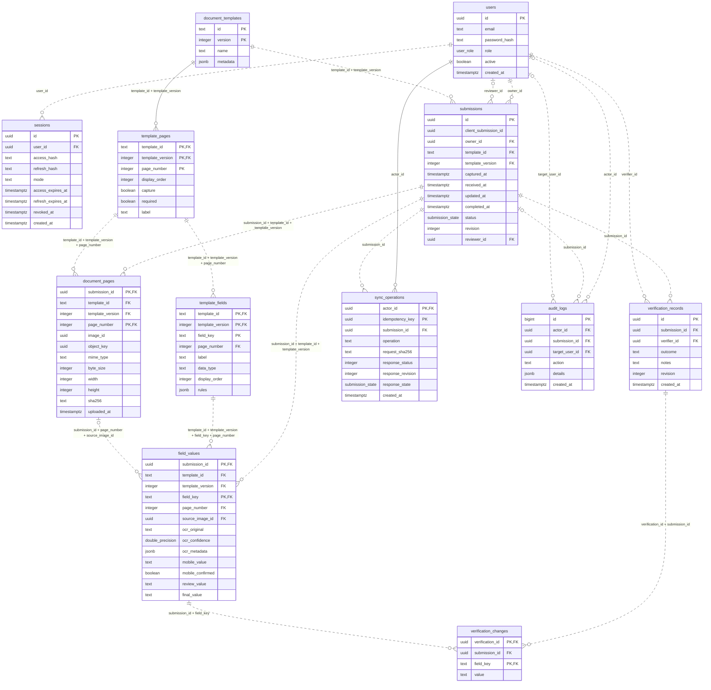

# T.A.L.A. Phase 2.1 database relationships

Crow’s feet show the number of child rows per parent. A circle at the parent end means the child can omit that relationship. Each connector represents one foreign key, including keys that span several columns. See [the migration](../../apps/backend/migrations/0001_foundation.sql) for the complete column pairs and [the data dictionary](data-dictionary.md) for field descriptions.

