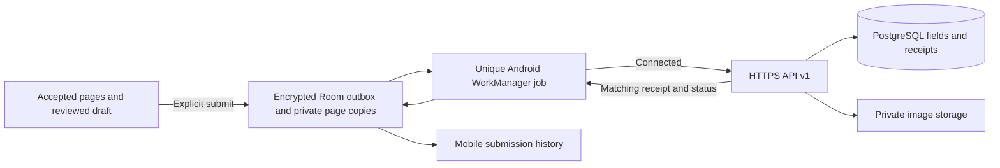

# T.A.L.A. Phase 2.2 mobile synchronization

The BEEF and SSS E-1 review screens can explicitly submit reviewed drafts from the phone. Saving a draft, capturing pages, reading OCR, and correcting values stay local. Submission history shows upload progress, a server reference after creation, synchronization time after acknowledgment, and the separate verification state.

## How a submission moves

1. Sign in once with a provisioned **ENCODER** account while connected. In **Submission history and sign-in**, enter the development or production HTTPS URL ending in `/api/v1`. The device must trust the server certificate. An optional `EXPO_PUBLIC_TALA_API_URL` in the scanner environment prefills the address. Choose the live endpoint in the sign-in screen. Keep credentials and database settings on the server.
2. Capture the applicable pages, compare and confirm every active field, and save the reviewed draft. Open **Submit for synchronization** in the draft. The phone freezes the accepted scan bytes, template version, UUIDs, capture date, raw OCR readings, and confirmed values. The original draft remains available. Changes made later to that draft stay local and a replacement submission uses a new reviewed draft UUID.
3. SQLite atomically stores the immutable snapshot, four types of operation keys, owner and server address, and initial queue state after staging the encrypted pages. The same draft UUID is unique in the outbox. WorkManager persists one named chain per draft and constrains it to a connected network. App launch, post-unlock boot, and package replacement reconcile queued rows with WorkManager. This also covers a stop between committing the SQLite row and committing the work request.
4. The worker restores the server ID and committed phase from the outbox and status endpoint. It compares returned page IDs, digests, MIME types, and byte counts with the accepted snapshots. It sends missing slots in order, the full field snapshot, and completion. It records every acknowledgment and uses the original key when the last response was lost.
5. The worker requires a matching live status and completion receipt with the correct submission ID, template, page acknowledgments, and timestamp. It commits the receipt and **Successfully synced** together. The encoder can refresh the independent verifier status in the history screen.

The existing drafts represent `LOCAL_DRAFT`. A durable outbox row starts at `QUEUED` and becomes `SYNCING` when a constrained worker starts. A retryable failure returns to `QUEUED` with a saved not-before time, retry count, and last error. Exhausted transient retries and fixable local storage or certificate failures become `SYNC_FAILED` with **Retry upload**. Authentication and permanent request or evidence failures become `SYNC_BLOCKED`. Signing in again with the same account and address requeues the authentication blocks. Validation and snapshot conflicts require review and a replacement intake when evidence must change. The original bytes and record remain available.

## Privacy and recovery

- The outbox uses its own version 1 Room database, `tala-sync.db`. It stores queue indexes and operational metadata alongside encrypted snapshots and progress. The worker reads these directly without React Native. The outbox has no destructive migration fallback. Existing BEEF and SSS database rows keep their format.
- AES-GCM uses an Android Keystore key with distinct associated data for session, snapshot, progress, and encrypted page copies. Queued page copies are in the app's no-backup directory. Access tokens live in memory. The encrypted vault stores the rotating refresh token and its encoder and server binding. The app still uses private storage for the original Phase 1 drafts and scans, with Android app backup disabled.
- OkHttp refuses redirects and uses system HTTPS validation, finite timeouts, and no transport-level automatic mutation retry. A worker stop cancels the current call. Per-account token rotation is serialized so concurrent workers do not reuse the same refresh token. Sign-out clears local credentials and attempts server revocation. Already queued documents remain bound to their original account and endpoint.
- Transient retries use WorkManager backoff and a persisted delay that respects a later server `Retry-After`. WorkManager may run later based on Android scheduling. The screen reads local progress while visible. Server status refresh is user-initiated for completed jobs.
- When validation fails, history displays safe field identifiers where the server supplied them. Local storage and scheduling failures preserve the existing draft and durably enqueued evidence. The sync implementation does not automatically delete local evidence, including after successful receipt.
- Android force-stop settings can suppress scheduled work until the next launch. Ordinary process recreation and boot rely on WorkManager and the queue reconciliation hooks. Their real-device behavior is listed in the [acceptance report](acceptance.md).

## API compatibility

The client uses the existing [Phase 2.1 OpenAPI contract](../phase-2.1/openapi.json) and [inspection notes](investigation.md). There are no production backend route, schema, or storage changes for this phase.

- `POST /auth/login` with `mode: "native"` followed by `GET /auth/me` confirms encoder identity. `POST /auth/refresh` sends the saved refresh credential in JSON. `POST /auth/logout` revokes that credential when the backend is reachable.
- `POST /submissions` carries the existing mobile draft UUID, template ID/version, and primary accepted capture time. The returned server UUID names subsequent status and mutation paths.
- `PUT /submissions/{id}/pages/{pageNumber}` uses original accepted bytes, MIME type, image UUID and SHA-256 with the actual API headers. BEEF uploads pages 1 and 2. SSS uploads page 1 and optional page 3. SSS page 2 stays a reference.
- `PUT /submissions/{id}/fields` submits confirmed values and raw evidence linked to the mapped page. Leading zeros remain strings. BEEF sends the matching raw result and available unambiguous single-crop confidence. SSS retains the chosen raw text, its confidence, and its bounding box even when the mobile reviewer corrected an invalid reading. Diagnostic alternatives remain in the existing local history.
- `POST /submissions/{id}/complete` and `GET /submissions/{id}/status` establish a durable acknowledgment. The status endpoint also resumes incomplete uploads and reads future verification decisions.

## Changes by file

- [App.tsx](../../apps/scanner/src/App.tsx) and [FixedFormWorkspace.tsx](../../apps/scanner/src/FixedFormWorkspace.tsx) expose submission controls and status in the existing BEEF and SSS interfaces.
- [SyncPanel.tsx](../../apps/scanner/src/SyncPanel.tsx) renders account sign-in, local status, progress, retry, and verifier status. [syncSnapshot.ts](../../apps/scanner/src/syncSnapshot.ts) maps confirmed drafts and image-linked OCR evidence.
- The [tala-sync module](../../apps/scanner/modules/tala-sync) registers the Expo bridge, WorkManager, and network and boot permissions. `SyncWork.kt` owns scheduling and worker state transitions. `SyncOutboxDatabase.java` defines the Room schema and queries. `SyncStorage.kt` handles the encrypted Room rows, credential vault, and accepted page copies. `EncoderSession.kt` owns native account and token handling. `SyncApi.kt` implements the HTTP contract, and `SyncProtocol.kt` defines the durable transfer and receipt checks.
- [Snapshot tests](../../apps/scanner/src/syncSnapshot.test.ts), the [Kotlin host fixture](../../apps/scanner/tests/SyncHost.kt), and the [host runner](../../scripts/test-sync-host.ps1) exercise the mapper and transport against actual storage.
- The backend changes are confined to [mobile sync integration tests](../../apps/backend/tests/mobile-sync.test.ts) and the [isolated test runner](../../apps/backend/tests/run-postgres.ts), which opts into the JVM client scenario when requested.

See the [implementation evidence and device limitations](acceptance.md) and the [Phase 2.3 verification handoff](phase-2.3-handoff.md). The native implementation follows the platform guidance for [WorkManager constraints and retries](https://developer.android.com/develop/background-work/background-tasks/persistent/getting-started/define-work), [Android Keystore](https://developer.android.com/reference/kotlin/android/security/keystore/KeyGenParameterSpec), and [Room](https://developer.android.com/jetpack/androidx/releases/room).
